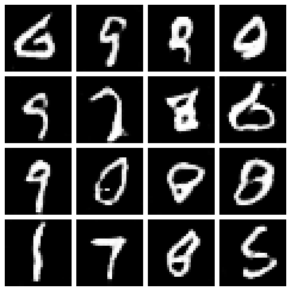

# GenAI API

FastAPI app built over three assignments for Applied Generative AI:

| # | Project | Endpoint(s) | Code |
|---|---|---|---|
| 1 | Simple text generation API: bigram model + spaCy embeddings | `POST /generate`, `POST /embedding` | `app/bigram_model.py`, `app/embedding_model.py` |
| 2 | CNN image classifier trained on CIFAR-10 | `POST /classify` | `helper_lib/model.py` (`SimpleCNN`), `app/image_classifier.py` |
| 3 | GAN trained on MNIST to generate handwritten digits | `GET /generate_digits` | `helper_lib/model.py` (`GAN`), `helper_lib/trainer.py` (`train_gan`), `app/digit_generator.py` |

## Project structure

```
genai/
├── app/                      # FastAPI service
│   ├── main.py               # all endpoints
│   ├── bigram_model.py
│   ├── embedding_model.py
│   ├── image_classifier.py   # loads models/cnn_cifar10.pth
│   ├── digit_generator.py    # loads models/gan_mnist_generator.pth
│   └── models/               # trained weights (committed, so no retraining needed)
├── helper_lib/               # reusable training code (Module 4 + Module 6 class activities)
│   ├── data_loader.py        # CIFAR-10 and MNIST loaders
│   ├── model.py              # get_model("FCNN" | "CNN" | "EnhancedCNN" | "GAN")
│   ├── trainer.py            # train_model, train_gan
│   ├── evaluator.py
│   ├── generator.py          # generate_samples / generate_grid for the GAN
│   ├── checkpoints.py
│   └── utils.py
├── notebooks/
│   ├── 01_text_generation.ipynb
│   ├── 02_cnn_cifar10.ipynb
│   └── 03_gan_mnist.ipynb
├── Dockerfile
├── pyproject.toml / uv.lock
└── README.md
```

## Run locally

```bash
uv sync
uv run fastapi dev app/main.py
```

Open http://127.0.0.1:8000/docs.

## Run with Docker

```bash
docker build -t genai-app .
docker run -p 8000:80 genai-app
```

Open http://127.0.0.1:8000/docs.

## Endpoints

| Method | Path | Input | Returns |
|---|---|---|---|
| GET | `/` | none | `{"Hello": "World"}` |
| POST | `/generate` | JSON `{"start_word": "bigram", "length": 5}` | `{"generated_text": "..."}` |
| POST | `/embedding` | JSON `{"word": "king"}` | 300-dim spaCy vector (404 if the word has no vector) |
| POST | `/classify` | multipart form, field `file` = .jpg/.png | `{"filename", "predicted_class", "confidence"}` |
| GET | `/generate_digits` | query `num_samples` (1–64, default 16), optional `seed` | PNG grid of generated digits |

```bash
curl -X POST http://127.0.0.1:8000/generate -H "Content-Type: application/json" -d '{"start_word": "bigram", "length": 5}'
curl -X POST http://127.0.0.1:8000/embedding -H "Content-Type: application/json" -d '{"word": "king"}'
curl -X POST http://127.0.0.1:8000/classify -F "file=@cat.jpg"
curl "http://127.0.0.1:8000/generate_digits?num_samples=16&seed=7" -o digits.png
```

## Assignment 2: CNN

`SimpleCNN`: 64×64×3 → Conv(16, 3×3, s1, p1) + ReLU → MaxPool 2×2 → Conv(32, 3×3, s1, p1) + ReLU → MaxPool 2×2 → Flatten (8192) → FC(100) + ReLU → FC(10).
CIFAR-10 images are resized from 32×32 to 64×64. Trained in `notebooks/02_cnn_cifar10.ipynb`.

## Assignment 3: GAN

**Generator:** noise (B, 100) → Linear → 7×7×128 → ConvTranspose2d(128→64, k4, s2, p1) + BatchNorm + ReLU → 14×14 → ConvTranspose2d(64→1, k4, s2, p1) + Tanh → 28×28

**Discriminator:** (1, 28, 28) → Conv2d(1→64, k4, s2, p1) + LeakyReLU(0.2) → 14×14 → Conv2d(64→128, k4, s2, p1) + BatchNorm + LeakyReLU(0.2) → 7×7 → Flatten → Linear → 1 → Sigmoid (probability "real")

**Training:** MNIST normalized to [-1, 1], BCE loss, Adam (lr 2e-4, betas 0.5/0.999), batch 128. See `notebooks/03_gan_mnist.ipynb`. Only the generator's weights are saved for the API (`app/models/gan_mnist_generator.pth`).

Sample output of `/generate_digits?num_samples=16&seed=7` after 10 epochs:


